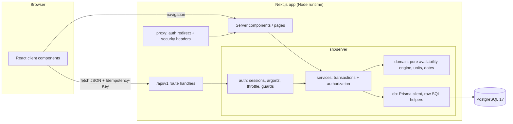
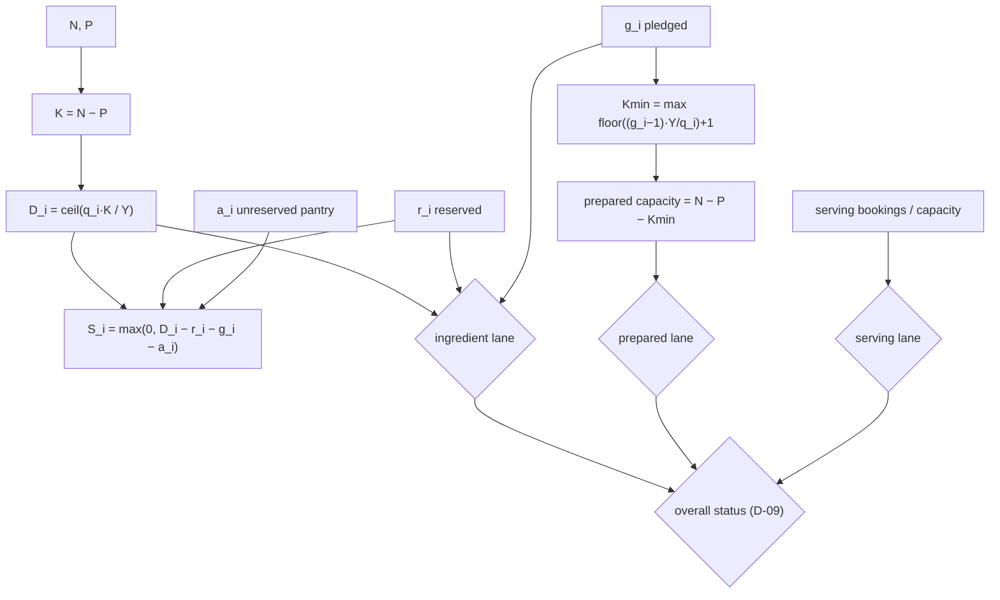
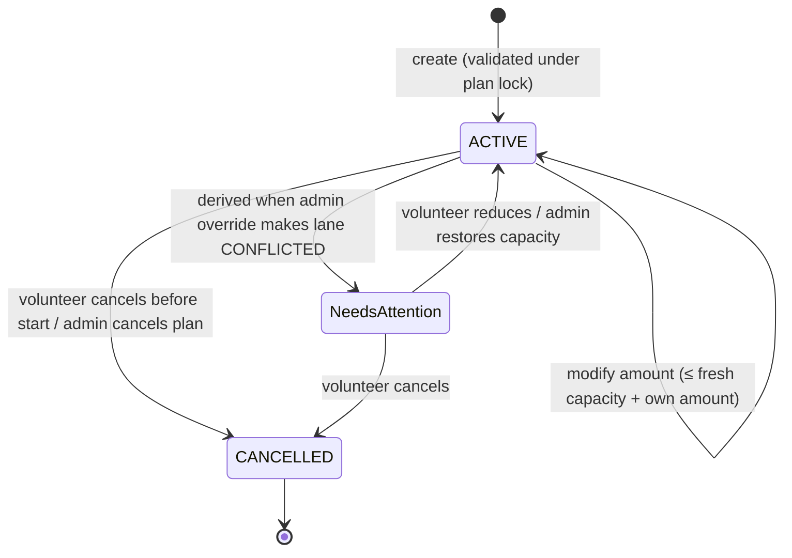
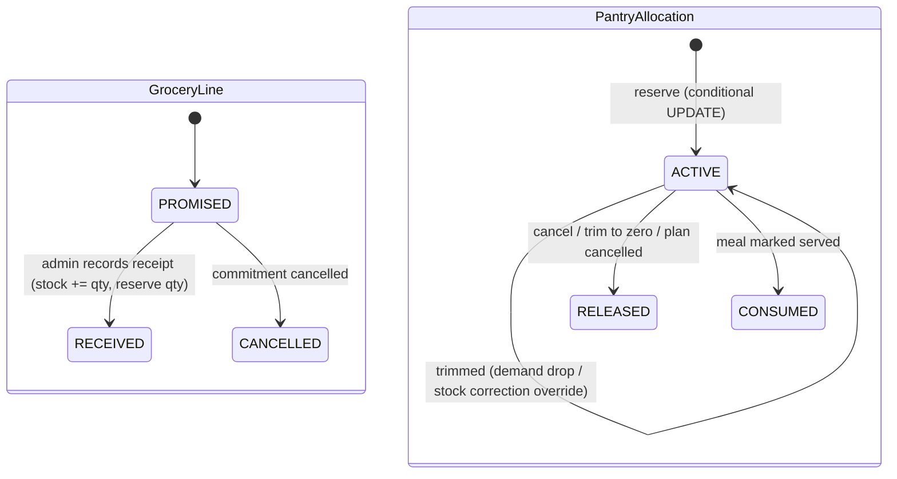
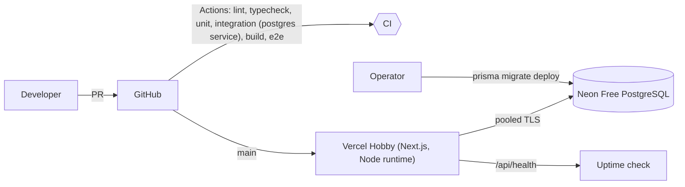

# Architecture

This document records the system architecture: a single Next.js application with a strict internal layering, backed by PostgreSQL. Decision IDs refer to `docs/assumptions-and-decisions.md`.

## 1. Stack options considered

| Option | Benefit | Cost | Verdict |
|---|---|---|---|
| **Next.js App Router monolith + Prisma + PostgreSQL** | One deployable, typed end to end, free hosting tiers exist, matches the brief | Server/client boundary needs discipline | **Chosen** |
| Separate React SPA + Express/Fastify API | Clear network boundary | Two deployables, duplicated types, more CI | Rejected: no demonstrated need |
| Django + HTMX | Mature admin and ORM | Python, but the brief prefers TypeScript, and the UX would be weaker | Rejected |
| Auth.js Credentials | Popular | Credentials logins only work with JWT sessions (D-26) | Replaced by custom DB sessions |
| Drizzle ORM | Lighter, SQL-like | The brief prefers Prisma | Prisma, with raw SQL for locks and conditional updates |

Versions are pinned in `package.json`. Compatibility was checked on 2026-11-14 against the npm registry and the Prisma 7 docs ([Prisma ORM v7](https://www.prisma.io/docs/orm/v7)), where the driver adapter is mandatory and the generator is `prisma-client`.

## 2. System architecture



The dependency rules are:

- `domain` imports nothing from the framework or the database. Its functions are pure and fully unit-tested.
- `services` is the only layer that opens transactions and checks authorization rules beyond role, such as membership and ownership.
- Route handlers parse input with Zod, call exactly one service function and map typed errors to HTTP.
- Server components may call read-only service functions directly.
- Client components never import from `src/server`. ESLint `no-restricted-imports` enforces this.

## 3. Component architecture (source tree)

```
src/
  app/
    (public)/page.tsx                landing: Enter as User / Administrator
    (public)/login/page.tsx          login form (?as=user|admin)
    (volunteer)/context/page.tsx     participation context
    (volunteer)/calendar/page.tsx    month grid + day agenda
    (volunteer)/meals/[slotId]/...   meal detail, prepared / groceries / pantry / serve panels
    (volunteer)/commitments/page.tsx my commitments
    admin/page.tsx                   dashboard
    admin/meals/...                  meal plan list + editor
    admin/pantry/...                 inventory, item history, incoming groceries
    api/v1/...                       REST handlers (docs/api-contracts.md)
    api/health/route.ts
  components/ui/                     shadcn/ui primitives
  components/                        app components (StatusBadge, MonthCalendar, LaneCard...)
  lib/                               shared client/server: zod schemas, api client, formatting
  server/
    auth/        session.ts password.ts throttle.ts guards.ts
    domain/      units.ts dates.ts availability.ts status.ts errors.ts
    services/    meal-plans.ts inventory.ts calendar.ts commitments/*.ts admin-ops.ts audit.ts idempotency.ts
    db/          client.ts tx.ts locks.ts
prisma/          schema.prisma migrations/ seed.ts
tests/           unit/ integration/ e2e/
```

## 4. Availability and fulfillment engine

The engine in `src/server/domain/availability.ts` is a single pure function, `computeAvailability(input) → MealAvailability`. Its input is the plan (N, Y, serviceCapacity, status, slot start), the live ingredient lines with `q_i`, and these aggregates: P, `r_i`, `g_i`, `a_i`, the serving count and the current time. It implements D-01 through D-10.



Every mutation follows the same order:

1. The handler authenticates, then the service locks the plan row.
2. It loads the aggregates and computes availability.
3. It validates the request against the freshly computed capacity.
4. It writes and audits.
5. It recomputes and returns the new availability in the response.

The client re-renders from that response. It never decides a color itself.

## 5. State machines

### Meal plan (D-16)

```mermaid
stateDiagram-v2
  [*] --> DRAFT: admin creates
  DRAFT --> DRAFT: edit
  DRAFT --> PUBLISHED: publish (validated)
  PUBLISHED --> PUBLISHED: edit (conflicts → 409 / acknowledged override)
  DRAFT --> CANCELLED: cancel
  PUBLISHED --> CANCELLED: cancel (warn if commitments; releases reservations)
  PUBLISHED --> COMPLETED: mark served (after start; consumes reservations)
  CANCELLED --> [*]
  COMPLETED --> [*]
```



### Commitment (volunteer booking)



`NeedsAttention` is derived from data, not stored (D-14).

### Grocery line and pantry allocation



## 6. Inventory allocation model

Each pantry item tracks:

| Quantity | Definition |
|---|---|
| on-hand | physical stock; changed only by admin receipts and corrections, grocery receipts and consumption |
| reserved | Σ ACTIVE allocations |
| available | on-hand − reserved |
| pledged | Σ PROMISED grocery lines, which are not stock |

```mermaid
sequenceDiagram
  participant V as Volunteer
  participant API as POST /meals/{id}/groceries
  participant DB as PostgreSQL
  V->>API: lines [{ingredientId, qty}], Idempotency-Key
  API->>DB: BEGIN; idempotency claim
  API->>DB: SELECT plan FOR UPDATE
  API->>DB: load aggregates (r_i, g_i, a_i)
  loop each ingredient (ascending pantryItemId)
    API->>DB: UPDATE pantry SET reserved += x WHERE onHand-reserved >= x  (x = pantry-coverable)
    API->>DB: INSERT allocation (PLAN_AUTO) + RESERVE txn
  end
  API->>API: recompute S_i; reject if qty > S_i
  API->>DB: INSERT commitment + grocery lines + audit
  API->>DB: COMMIT
  API-->>V: 201 + fresh MealAvailability
```

If a step after the reservations rejects the request, the whole transaction rolls back, including the reservations. A volunteer either gets everything they asked for or nothing.

## 7. Authentication and authorization

```mermaid
sequenceDiagram
  participant B as Browser
  participant L as POST /api/v1/auth/login
  participant DB as PostgreSQL
  B->>L: username, password, portal (user|admin)
  L->>DB: throttle check (username key, ip key)
  L->>DB: find user by lower(username)
  L->>L: argon2id verify (dummy hash if unknown)
  alt ok and role matches portal
    L->>DB: INSERT session(sha256(token), expiresAt)
    L-->>B: Set-Cookie fh_session=token; HttpOnly; SameSite=Lax; Secure(prod)
  else
    L->>DB: INSERT LoginAttempt(fail)
    L-->>B: 401 "Invalid username or password."
  end
```

The rules are:

- The portal choice is only a UX hint. Logging in through the admin portal with a USER account fails with the generic message. A user can never become admin through it, because the role is read from the `User` row on every request.
- `requireUser()`, `requireVolunteer()` (role USER plus a context selected) and `requireAdmin()` guard pages and handlers. On API routes they return 401 or 403, and on pages they redirect.
- Every mutation is a non-GET request that must carry an `Origin` header matching `APP_ORIGIN` (D-29).
- The proxy (`src/proxy.ts`, Next 16's renamed middleware) only does cheap cookie-presence redirects and sets security headers. It never makes an authorization decision.

## 8. Data validation strategy

| Layer | Responsibility |
|---|---|
| Client | React Hook Form + Zod for immediate feedback. Advisory only. |
| Route handler | The same Zod schemas from `src/lib/schemas`. Rejects with `422 VALIDATION_ERROR` and `{fieldErrors}`. Integer coercion is strict: `"60.5"`, `"abc"`, `0` and `-1` all fail. |
| Service | Business validation against freshly locked state (capacity, membership, slot open, unit kind) with typed `DomainError` codes. |
| Database | CHECK, FK and unique constraints as the last line (`docs/database-design.md`). |

## 9. Deployment architecture



Both providers have free tiers. Nothing is provisioned without authorization (§23 of the brief), and `docs/deployment.md` holds the exact steps.

## 10. Threat model (STRIDE summary)

| Threat | Vector | Mitigation |
|---|---|---|
| Spoofing | Credential stuffing | Argon2id, per-username and per-IP throttling, generic errors, timing-equalized unknown users (D-27) |
| Spoofing | Session theft | 160-bit random tokens with only hashes stored; HttpOnly + Secure + SameSite=Lax cookies; 12 h expiry; logout revokes |
| Tampering | Client-sent role, status, org or quantity | Role is read from the DB; status is computed server-side; org is checked against membership; quantities re-validated under lock |
| Tampering | CSRF | SameSite=Lax plus Origin check on all mutations; no state-changing GET requests |
| Tampering | SQL injection | Prisma parameterization; raw SQL only through tagged-template `$queryRaw` |
| Repudiation | Disputed stock change | Append-only `InventoryTransaction` and `AuditLog` rows carrying actor ids |
| Information disclosure | Cross-organization snooping | Calendar and detail queries are scoped by context in the service layer (D-23); responses never include other users' ids |
| Information disclosure | Stack traces | Error mapper returns `{code, message}`; details go to server logs only |
| Information disclosure | XSS | React escaping; no `dangerouslySetInnerHTML`; CSP headers |
| Denial of service | Login floods | Throttling. Platform-level rate limiting is left to the host. |
| Elevation of privilege | Hitting admin APIs as a user | `requireAdmin()` in every admin handler, with integration tests per endpoint (E2E-13) |
| Elevation of privilege | Demo reset on production | Reset script refuses non-local URLs and `NODE_ENV=production` |
