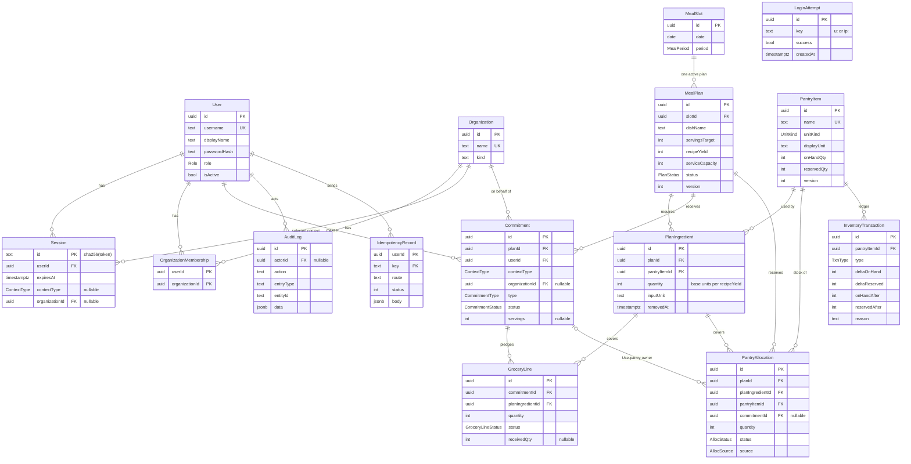

# Database Design

PostgreSQL 17, accessed through Prisma 7 with the `@prisma/adapter-pg` driver adapter. The schema lives in `prisma/schema.prisma`. Constraints that Prisma cannot express, namely CHECK constraints and partial unique indexes, are added by hand to the SQL of the migration that creates the table, and each one is listed below.

## Conventions

- Primary keys are `uuid` values from `gen_random_uuid()`, except `Session.id`, which is the SHA-256 hex digest of the token.
- Quantities are `integer` values in base units: grams, millilitres or each (D-21).
- Meal dates are `date` values with no time zone (D-32).
- Timestamps are `timestamptz`.
- Rows that carry history are never hard-deleted. Commitments, allocations and grocery lines move to a terminal status instead, and plan ingredients get `removedAt`.
- Foreign keys use `ON DELETE RESTRICT` unless noted.

## ER diagram

## Enumerations

| Enum | Values |
|---|---|
| Role | USER, ADMIN |
| MealPeriod | BREAKFAST, LUNCH, DINNER |
| PlanStatus | DRAFT, PUBLISHED, COMPLETED, CANCELLED |
| UnitKind | MASS, VOLUME, COUNT |
| ContextType | SOLO, ORGANIZATION |
| CommitmentType | PREPARED_FOOD, GROCERY, PANTRY, SERVING |
| CommitmentStatus | ACTIVE, CANCELLED |
| GroceryLineStatus | PROMISED, RECEIVED, CANCELLED |
| AllocationStatus | ACTIVE, RELEASED, CONSUMED |
| AllocationSource | USE_PANTRY, PLAN_AUTO, GROCERY_RECEIPT |
| InventoryTxnType | INITIAL, RECEIPT, CORRECTION, ADJUSTMENT, GROCERY_RECEIPT, CONSUMPTION, RESERVE, RELEASE |

## Integrity constraints (hand-written SQL in migrations)

| Name | Table | Rule | Why |
|---|---|---|---|
| `pantry_qty_check` | PantryItem | `onHandQty >= 0 AND reservedQty >= 0 AND reservedQty <= onHandQty` | Last line of defense against over-allocation (D-17) |
| `plan_positive_check` | MealPlan | `servingsTarget > 0 AND recipeYield > 0 AND serviceCapacity >= 1` | D-16 |
| `plan_one_active_per_slot` | MealPlan | partial unique `(slotId) WHERE status <> 'CANCELLED'` | A slot has at most one live plan, and cancelled plans stay as history |
| `plan_ingredient_qty_check` | PlanIngredient | `quantity > 0` | |
| `plan_ingredient_unique_live` | PlanIngredient | partial unique `(planId, pantryItemId) WHERE removedAt IS NULL` | No duplicate live lines for the same item |
| `commitment_context_check` | Commitment | `(contextType='SOLO' AND organizationId IS NULL) OR (contextType='ORGANIZATION' AND organizationId IS NOT NULL)` | FR-10 |
| `commitment_servings_check` | Commitment | `(type='PREPARED_FOOD') = (servings IS NOT NULL) AND (servings IS NULL OR servings > 0)` | FR-28 |
| `commitment_one_active` | Commitment | partial unique `(planId, userId, type) WHERE status='ACTIVE'` | D-11 |
| `grocery_qty_check` | GroceryLine | `quantity > 0 AND (receivedQty IS NULL OR receivedQty >= 0)` | |
| `allocation_qty_check` | PantryAllocation | `quantity > 0` | Trims that reach zero set status `RELEASED` and keep the last positive quantity in the audit log |

The capacity rules, such as P never exceeding N − Kmin and pledges never exceeding the shortage, depend on data in several tables and cannot be CHECK constraints. They are enforced inside one transaction per meal, which locks the meal-plan row with `SELECT … FOR UPDATE` (D-28). Integration tests in `tests/integration/concurrency.int.test.ts` exercise them with parallel connections.

## Indexes

| Table | Index | Serves |
|---|---|---|
| MealSlot | unique `(date, period)` | Calendar range scans |
| Commitment | `(planId, status)`, `(userId, status)`, `(organizationId, status)` | Lane aggregates, My Commitments, organization view |
| PantryAllocation | `(pantryItemId, status)`, `(planId, status)` | Allocated-elsewhere figures, reconciliation |
| GroceryLine | `(planIngredientId, status)` | Pledged sums |
| InventoryTransaction | `(pantryItemId, createdAt)` | Item history |
| LoginAttempt | `(key, createdAt)` | Throttle window |
| Session | `(userId)`, `(expiresAt)` | Revocation, expiry cleanup |
| AuditLog | `(entityType, entityId)`, `(createdAt)` | Entity history, recent activity |

## Ledger invariant

For every pantry item, the transaction ledger reconciles exactly with the item's current columns:

- `Σ deltaOnHand = onHandQty`
- `Σ deltaReserved = reservedQty`

`RESERVE` and `RELEASE` transactions change only `reservedQty`. `CONSUMPTION` lowers both columns by the same amount. The integration suite checks both identities after every inventory scenario, which is how a double subtraction would be caught.

## Migrations

- Developers run `npm run db:migrate` (`prisma migrate dev`), which creates a reviewable SQL migration under `prisma/migrations/`. Hand-written constraints are appended to that SQL before the migration is committed.
- CI and production run `prisma migrate deploy`, which only applies committed migrations. A destructive change (drop, narrowing type change) needs a two-step expand/contract migration and explicit sign-off (`docs/deployment.md`).

## Seed and reset

- `npm run db:seed` is idempotent: it upserts the demo dataset described in `docs/requirements.md` §7.
- `npm run demo:reset` truncates every table and reseeds. It refuses to run unless `DATABASE_URL` points to localhost or `ALLOW_DEMO_RESET=true` is set, and it always refuses when `NODE_ENV=production`.
